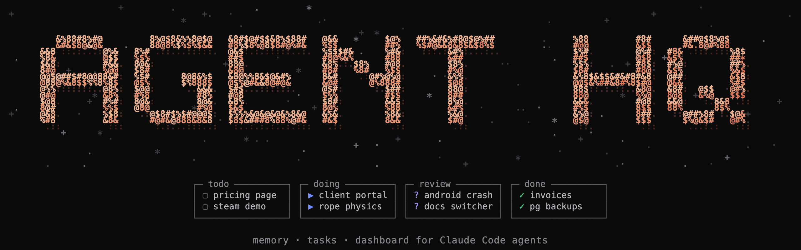
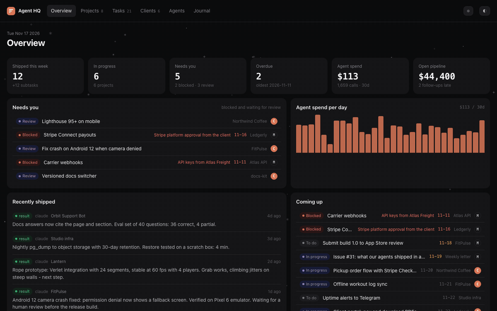
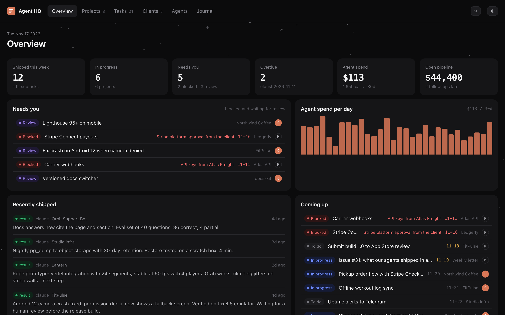
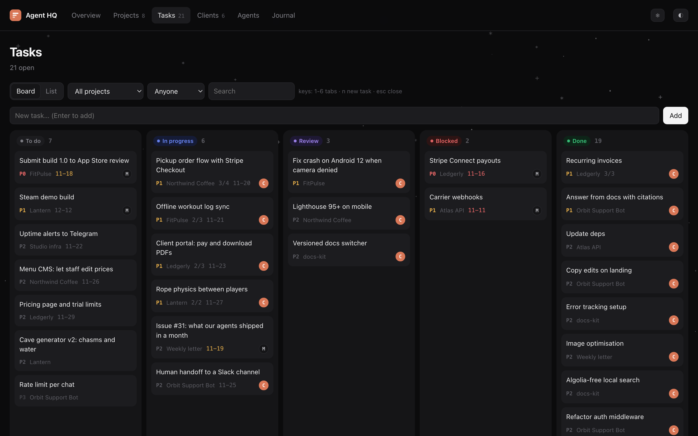
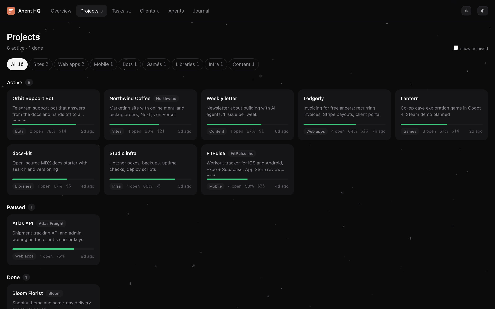
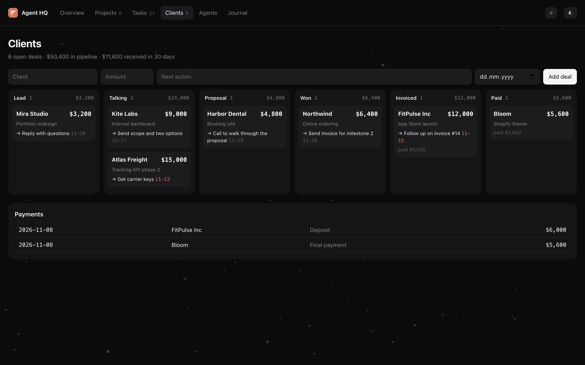

<p align="center"></p>

# Agent HQ

**Claude Code forgets everything between sessions. Agent HQ gives it a memory, a task list it keeps itself, and you a dashboard of every project it touches.**



Every new Claude Code session starts from zero: it re-reads the codebase, re-discovers what was done yesterday, and loses the task you mentioned in passing an hour ago. A rule in `CLAUDE.md` is read once and fades by mid-conversation.

Agent HQ fixes that with hooks, not prompts. A hook runs every time:

- **Session start**: the agent gets *where we left off*, open tasks, blockers and the latest decisions for this project. No re-exploring.
- **You ask for work**: the agent records it as a task before starting, splits it into subtasks, and moves it across the board as it works.
- **Session end**: if files were edited but nothing was written down, the session cannot end until the agent writes a result entry. That entry becomes *where we left off* for the next session.

Everything lands in one local SQLite file and a dashboard at `localhost:7788`: projects grouped by type, a board you can drag tasks on, a client pipeline, and **what your agents cost per project** in dollars.

Pure Python standard library. No accounts, no cloud, no dependencies.

## Install

In Claude Code:

```
/plugin marketplace add romanov-d/agent-hq
/plugin install agent-hq@agent-hq
```

Start a new session. Agent HQ registers the folder you are in, and Claude offers to import the rest of your projects:

```
/agent-hq:onboard
```

It scans your usual code folders (`~/GitHub`, `~/Projects`, `~/code`, ...), detects what each repo is (site, web app, mobile, bot, game, library...) from its files, pulls a summary from the README and recent commits, and registers them. Open the dashboard:

```
/agent-hq:dashboard
```

Needs `python3` (3.8+) on your PATH. macOS and Linux; Windows via WSL.

## What you get

| | |
|---|---|
| **Memory across sessions** | A briefing at every session start: summary, where we left off, open tasks, recent journal. |
| **Tasks the agent keeps** | Created when you ask, subtasks for anything bigger than one step, statuses `todo → doing → review → done`, `blocked` with what we wait for. |
| **No silent exits** | The Stop hook refuses to end a session that changed files and recorded nothing. |
| **Dashboard** | Overview, projects by section, Board and List views with drag and drop, task drawer with subtasks, client pipeline, agent sessions, journal. Light and dark. Keys `1`-`6`, `n`, `Esc`. |
| **Agent cost** | Reads your local Claude Code transcripts and attributes spend to projects by working directory. |
| **Client pipeline** | Drag deals across stages, open a deal to edit amount, next step and date, record payments. For freelancers and small studios. |
| **MCP server** | 12 tools (`briefing`, `task_add`, `task_update`, `log`, `import_projects`, `agent_cost`...) usable from Claude Code, Claude Desktop or any MCP client. |
| **CLI** | `agent-hq` for you and for scripts: `agent-hq t add`, `agent-hq log`, `agent-hq scan --add`, `agent-hq cost`, `agent-hq ui`, `agent-hq doctor`. |

| | |
|---|---|
|  |  |
|  |  |

## How it works

```
 you ──► Claude Code ──► hooks ─────────┐
              │                          ▼
              └──► MCP tools ──► ~/.agent-hq/agent-hq.db ◄── agent-hq CLI
                                         │
                                 dashboard :7788
```

| Hook | When | Does |
|---|---|---|
| `SessionStart` | session opens | registers the folder if it's a project, prints the briefing |
| `UserPromptSubmit` | each message | if it reads like a request for work, reminds the agent to record a task (~40 tokens, silent otherwise) |
| `Stop` | agent wants to stop | blocks once if work happened and nothing was recorded |
| `SessionEnd` | session closes | closes the session row, so time per project is known |

The plugin also ships a skill (`agent-hq`) with the working protocol, and slash commands `/agent-hq:onboard`, `/agent-hq:brief`, `/agent-hq:wrap`, `/agent-hq:dashboard`.

### Projects are detected, not configured

A folder becomes a project when it has `.git`, `package.json`, `pyproject.toml`, `Cargo.toml`, `go.mod`, `project.godot`, `pubspec.yaml`, `CLAUDE.md` and similar. Its section comes from the files: Expo or React Native means mobile, Telegram or Discord libraries mean bot, Godot means game, Next/React with a database client means web app, and so on. Your home folder and catch-all folders like `~/Documents` never become projects. Remove a project in the dashboard and it will not be re-added.

## Configuration

| Variable | Default | |
|---|---|---|
| `AGENTHQ_DB` | `~/.agent-hq/agent-hq.db` | database file |
| `AGENTHQ_PORT` | `7788` | dashboard port |
| `AGENTHQ_STOP` | `block` | `remind` prints a note instead of blocking, `off` disables the Stop hook |
| `AGENTHQ_AUTO_REGISTER` | `1` | `0` stops auto-registering folders on session start |
| `AGENTHQ_TRANSCRIPTS` | `~/.claude/projects/*/*.jsonl` | where agent cost is read from |

Model prices for the cost view are in [`agenthq/prices.json`](agenthq/prices.json). Check them against the official pricing page and edit if needed.

## Privacy and safety

- Everything stays on your machine: one SQLite file, one local server bound to `127.0.0.1`.
- The dashboard rejects foreign `Host` headers and cross-site writes.
- Agent HQ stores what you and the agent write. Don't put secrets in task bodies; the skill tells the agent the same.

## Try it with demo data

```bash
git clone https://github.com/romanov-d/agent-hq && cd agent-hq
AGENTHQ_DB=/tmp/agent-hq-demo.db python3 demo/seed.py
AGENTHQ_DB=/tmp/agent-hq-demo.db AGENTHQ_TRANSCRIPTS='/tmp/agent-hq-demo-transcripts/*.jsonl' bin/agent-hq ui
```

## Use without the plugin

Add the hooks to `~/.claude/settings.json` with absolute paths (see `hooks/hooks.json`, replace `${CLAUDE_PLUGIN_ROOT}` with the clone path), and register the MCP server:

```bash
claude mcp add agent-hq -- python3 /path/to/agent-hq/agenthq/mcp_server.py
```

## Development

```bash
python3 -m unittest discover tests   # no dependencies
bin/agent-hq doctor                        # checks hooks, database, MCP server
```

## Why this exists

I run a small studio where most code is written by Claude Code agents: sites, apps, bots, games, about 150 project folders. The problem was never the code. It was continuity: what happened yesterday, what the client asked for on Tuesday, what the agent was in the middle of when the session ended. Agent HQ is the system I built for that and use every day, cleaned up for everyone.

## License

MIT
